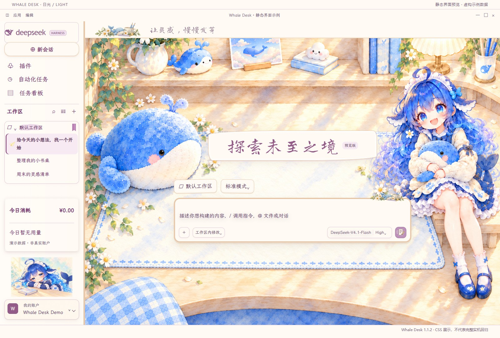
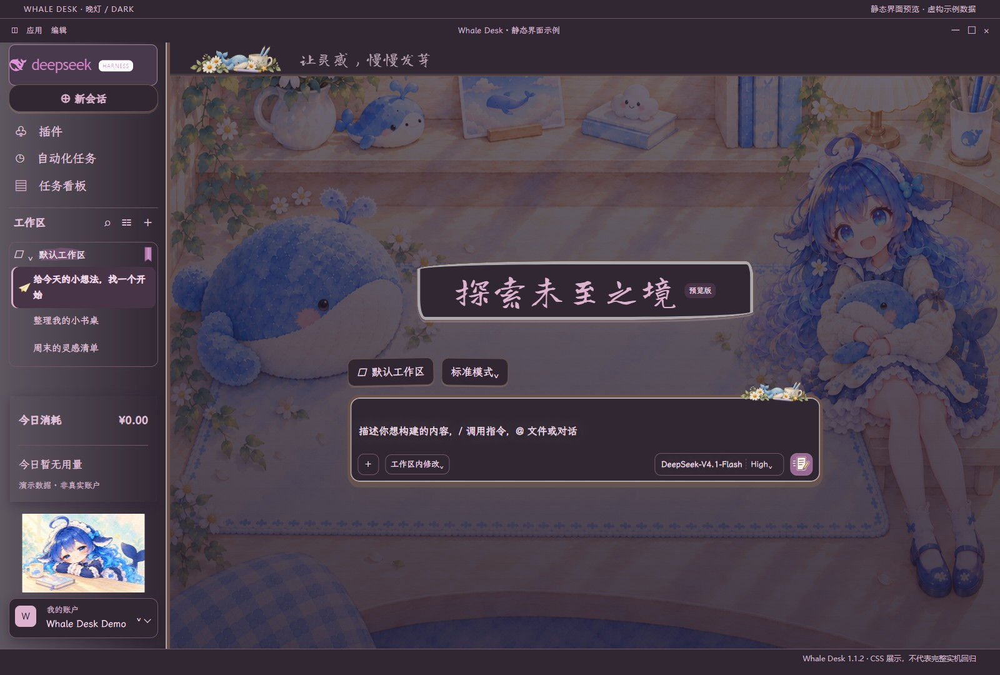

# 鲸伴 · 水彩小书桌

[English](README.md)

Whale Desk 1.1.2 是 DSH 的非官方水彩小书桌皮肤，基于 Alphazerolan 的
[DIY Journal 1.14.1](https://github.com/Alphazerolan/diy-journal-skin) 改造。
奶油暖木、紫粉柔字和鲸鱼娘配图保留原生的侧栏、对话区与工作台布局。

## 安装与更新

将整个目录复制到 `$DSH_HOME/skins/whale-desk`；默认位置是
`~/.dsh/skins/whale-desk`。在 DSH 的“设置 → 皮肤”选择 Whale Desk。
使用皮肤不需要构建、Node.js 或 Python。更新前先备份个人修改。
覆盖正在使用的皮肤文件后，先恢复“官方默认”，再应用 Whale Desk，
再核验新样式。此操作不保证清除旧窗口的缓存，详见文末更新提示。

本包仅包含 CSS、字体和素材，不注册可执行钩子。桌宠由独立的 DSH
宠物插件管理，本包不含桌宠动画，也不是 DeepSeek 手机 App 主题。

## 预览与验证

图片使用随包 CSS 和虚构数据渲染，属于静态示例。Windows / DSH
0.2.1-rc.2 / Skin Center 0.4.8 已完成部分真实操作检查；隔离浏览器还
检查了 Skin Center 0.4.8、0.4.16 转换后的 CSS。
具体通过项和未测范围以[测试记录](TESTING.md)为准。

## DIY 与许可

配套源码仓库（目前为私有）提供离线配置器、
JSON 应用工具、详细说明书与组件图册。维护者修改 `DESK-OVERRIDES.css`
后，需要同步到实际加载的 `patches.css`。

代码许可见 [LICENSE](LICENSE)，插画范围见 [LICENSE-ARTWORK](LICENSE-ARTWORK)。
角色、字体及上游署名见 [NOTICE](NOTICE)，逐图来源与哈希见 [ARTWORK.json](ARTWORK.json)。
插画仅限个人非商业使用；角色再分发授权尚未独立核实，已向市场审核披露。

更新提示：0.4.8 的现有桌面窗口可能仍保留原路径旧样式。恢复默认后重应用不保证清除；请在后台任务结束后正常重开 DSH，再核验新版本。此次未强制重启正在运行任务的宿主。
